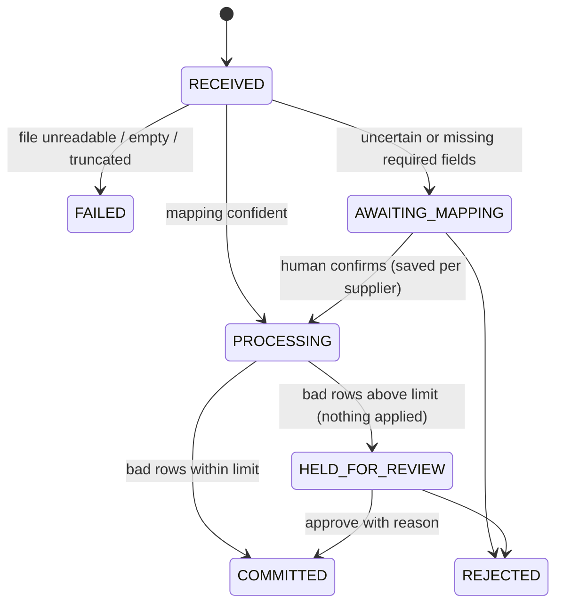
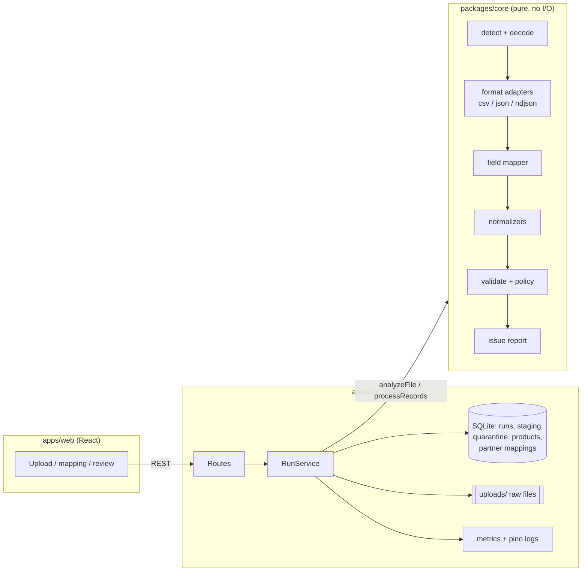

# Supplier feed intake

An ingestion and normalization service for messy partner product feeds. It reads CSV, JSON and NDJSON files whose columns and formats change without notice. It maps them onto one product model, sets bad rows aside with a reason the supplier can act on, and holds back any file that is too broken to apply.

Built for the Adobe Forward Deployed Engineer take-home. The customer context I assumed is in [docs/customer-note.md](docs/customer-note.md).

- [Quick start](#quick-start)
- [Demo script](#demo-script-10-minutes)
- [What it does](#what-it-does)
- [Architecture](#architecture)
- [Key decisions and trade-offs](#key-decisions-and-trade-offs)
- [Assumptions](#assumptions)
- [Testing](#testing)
- [Observability and operations](#observability-and-operations)
- [Performance and scaling](#performance-and-scaling)
- [Known limitations and what I would do next](#known-limitations-and-what-i-would-do-next)
- [Use of AI](#use-of-ai)

## Quick start

Requirements: **Node.js 22.13 or newer** (it uses the built-in `node:sqlite`, so there are no native modules to compile).

```bash
npm install
npm run dev          # API on :3000, UI on http://localhost:5173
```

Other commands:

```bash
npm test             # 155 tests: core pipeline, format contracts, API flows
npm run typecheck
npm start            # builds the UI and serves UI + API from :3000
npm run ingest -- fixtures/peak/catalog.json --partner peak --accept-suggestions   # CLI, no server needed
```

State lives in `./data` (SQLite database and stored uploads). Delete the folder to start fresh. Two demo suppliers are seeded from `fixtures/partners.json`.

## Demo script (10 minutes)

Use the UI, or the curl lines below (`-F` posts a multipart form).

| # | File | Expected result | What it shows |
|---|------|-----------------|---------------|
| 1 | `fixtures/nordwind/week1_catalog.csv` | **Imported**, 30 new products | A German ERP export (`;` separators, decimal commas, Windows-1252 encoding). Every column is matched through known aliases. |
| 2 | `fixtures/nordwind/week2_catalog.csv` | **Needs mapping** | The supplier's ERP upgrade renamed columns (`Artikel-Nr.`, `VK-Preis`, `Lagerbestand`) and added `Farbe`. The UI shows the column drift and asks only about the three uncertain columns. |
| 2b | Confirm the mapping | **Imported**, 29 updated, 1 set aside | Line 9 has the price "auf Anfrage". The confirmed mapping is saved for this supplier. |
| 3 | `fixtures/nordwind/week3_catalog.csv` | **Held for review** | Same layout, so no questions this time. But the export lost most prices: 65% of rows are bad against a 5% limit, so nothing is applied. You can download the set-aside rows, approve the good rows with a reason, or reject the file. |
| 4 | `fixtures/peak/catalog.json` (supplier: Peak) | **Needs mapping**, then **Imported** | Nested JSON from an API. `pricing.amount`, `inventory.onHand` and `identifiers.upc` are matched automatically. US dates like `03/04/2026` are read using the supplier's locale and flagged. A bad UPC drops only that field; a "TBD" price sets that row aside. |
| 5 | `fixtures/peak/inventory.ndjson` (type: inventory update) | **Imported**, 2 set aside, 23 unknown SKUs skipped | One corrupt line and one negative stock value are set aside. Inventory updates never create products. |
| 6 | Upload week 1 again | **409 Duplicate file** | Idempotency by content hash. The UI offers "Import it again anyway". |

```bash
curl -F partnerId=nordwind -F importType=full_catalog -F file=@fixtures/nordwind/week2_catalog.csv localhost:3000/api/runs
curl -X POST localhost:3000/api/runs/<runId>/mapping -H 'content-type: application/json' \
  -d '{"decisions":{"Artikel-Nr.":"sku","VK-Preis":"price","Lagerbestand":"quantity","Farbe":null}}'
curl localhost:3000/api/runs/<runId>/quarantine -o rejected.csv
curl localhost:3000/metrics | grep feed_
```

The fixtures are generated deterministically by `scripts/generate-fixtures.ts`, and `packages/core/test/pipeline.test.ts` pins this whole story. If a change breaks the demo, CI fails.

## What it does

1. **Reads any supported format through one adapter interface.** It detects the format (explicit choice, then file extension, then content sniffing), decodes UTF-8 or falls back to Windows-1252, and streams records out. Nested JSON is flattened to dot paths (`pricing.amount`).
2. **Maps source fields onto the product model, with a confidence score and a reason.** Known aliases and fields confirmed earlier are applied automatically. Similar-looking names and value patterns become suggestions that a person confirms once; the decision is saved for that supplier.
3. **Normalizes values with the supplier's locale.** For example `1.234,56`, `03/04/2026`, `€12,50`, `Auf Lager`, `https://schema.org/InStock`, EANs that lost a leading zero in Excel, and UPCs in scientific notation (rejected). Ambiguous values are resolved by the locale and reported, never guessed silently.
4. **Validates per import type.** A bad value in a required field sets the row aside. A bad value in an optional field drops that field and adds a warning.
5. **Decides per file.** If the share of set-aside rows exceeds the import type's limit, the run is **held**: accepted rows wait in staging until someone approves or rejects them. The limit can be changed for a single upload, within 0–50% and with a reason that is stored with the run.
6. **Reports so people can act.** Issues are grouped by code and column, with counts, example values, locations (CSV line or JSON pointer) and a hint on how to fix them. Set-aside rows can be downloaded with their reasons attached, so the supplier can fix and resend just those rows.

Run lifecycle:



## Architecture



```
packages/core/src
  formats/      FormatAdapter interface, registry + detection, csv, json/ndjson, decode, flatten
  mapping/      header normalization, similarity, proposeMapping / applyDecisions
  normalize/    locale-aware value normalizers
  schema/       canonical product model, import types (config)
  pipeline/     analyzeFile, processRecords, issue aggregation, quarantine export
  errors.ts     issue codes, severity rules, fix hints
apps/api/src    app.ts (routes), runService.ts (orchestration), db.ts, metrics.ts
apps/web/src    App.tsx, api.ts, styles.css
scripts/        fixture generator, CLI, large-feed generator, benchmark
docs/           customer note, ADRs, how to add a format
```

The pipeline runs in two phases:

- **`analyzeFile`** reads only the head and a sample of records. It detects the format, profiles the fields and proposes a mapping. It is cheap and writes nothing, so a person can confirm the mapping before anything happens.
- **`processRecords`** streams every record through mapping, normalization and validation into a sink. It returns the decision and the grouped report. The API's sink writes to staging and quarantine tables; the CLI and the benchmark use in-memory sinks.

## Key decisions and trade-offs

Longer write-ups are in [docs/adr](docs/adr).

| Decision | Why | Cost |
|---|---|---|
| **Fuzzy mapping with confidence bands** ([ADR 1](docs/adr/0001-fuzzy-mapping-with-confidence-bands.md)): ≥0.90 applied automatically, 0.65–0.90 a person confirms, <0.65 not imported. A fuzzy name match is capped at 0.88 and needs value evidence to be applied automatically. Required fields are never applied automatically from a fuzzy match. Conflicts always go to a person. | Renamed columns are the most common kind of drift. Asking once and remembering the answer is cheap; silently mapping "Sale price" onto "price" is expensive. | The first file after a supplier changes its export needs a person. The thresholds are tuned on the fixtures, not on production data. |
| **Set rows aside, plus a per-file limit by import type** ([ADR 2](docs/adr/0002-quarantine-and-thresholds.md)): `full_catalog` 5%, `price_update` 2%, `inventory_update` 10%. The limit can be changed per upload within 0–50%, with a stored reason. | Good rows should not wait for bad ones, but a mostly broken file usually means a broken export, and half-applying it damages the catalog. | Approval is a manual step. A small file hits the limit with very few bad rows (1 bad row in 20 = 5%). |
| **Staging before commit** | "Held" has to mean that nothing was applied. Approving later does not re-run the file. | Extra write per row. |
| **Field-level writes** | A price update must not blank out names. Update-only import types never create products. | Promotion builds the UPDATE per row. |
| **Format adapters behind one interface** ([ADR 3](docs/adr/0003-format-adapters.md)) | New formats should not touch the mapper or validator. A shared contract test suite runs against every adapter. | Flattening nested JSON loses array semantics beyond "join scalars with `|`". |
| **Truncated JSON fails the run; a corrupt CSV row or NDJSON line only sets that record aside** | You can't know what a cut-off document is missing. A line-based format isolates the damage. | A partner with a flaky export has to resend the whole JSON file. |
| **SQLite (`node:sqlite`) and synchronous processing** ([ADR 4](docs/adr/0004-sqlite-and-synchronous-processing.md)) | Zero setup for reviewers, transactional, and the schema maps onto Postgres. | One writer: runs are processed one after another, inside the request. |
| **No LLM in the pipeline** | Mapping and normalization are deterministic and testable, and every decision has a stated reason. | Unknown vocabularies need aliases added by hand. See "next" below. |

## Assumptions

- **Customer:** a mid-size retailer that ingests product, price and stock feeds from many suppliers into its commerce platform. See [docs/customer-note.md](docs/customer-note.md).
- **One file holds one record type** (products), identified by SKU, which is unique per supplier.
- **Suppliers are configured up front.** The config holds the locale (decimal separator, date order, default currency) and an optional JSON record path. The two demo suppliers are seeded. There is no authentication: this is a single-tenant demo.
- **A full catalog import upserts and never deletes** products that are missing from the file. Deleting from a feed is too dangerous to do implicitly.
- **Price and inventory updates only touch their own fields** and skip SKUs that are not in the catalog yet. Those are counted as `unknownSkus`.
- **Duplicate SKUs in one file:** the last occurrence wins, with a warning.
- **Dates without a timezone are UTC.** `DD.MM.YYYY` is always read day-first. Other ambiguous dates use the supplier's locale and raise a warning.
- **Files are at most 50 MB** (`MAX_UPLOAD_MB`). They are processed synchronously, and the raw file is kept under `data/uploads` for audit and re-processing.
- **The same file (by SHA-256) is not re-imported** for the same supplier and import type unless `force=true` is sent.

## Testing

`npm test` runs 155 tests in about 2 seconds:

- **Format contract suite** (`formats.contract.test.ts`): every registered adapter must yield flat records in order, report locations, set a malformed record aside without stopping, fail empty files, and recognize its own sample. A new format adds its samples here.
- **Normalizers**: table-driven cases for locales, ambiguity, spreadsheet damage, invalid calendar dates and GTIN check digits.
- **Mapper**: aliases (including German), nested paths, the required-field safety rule, value evidence pushing a score up or down, conflicts, saved decisions, and `applyDecisions` explaining what is still wrong.
- **Pipeline**: the demo story end to end, plus a check that the same products sent as CSV and as JSON normalize identically, plus fatal-file cases.
- **API** (Fastify `inject`, in-memory DB): the full upload, confirm, hold, approve flow; the duplicate guard; override validation; the quarantine download; and the metrics output.

Deliberately not covered: browser tests for the UI (checked manually and with screenshots), concurrency, and property-based fuzzing of the parsers. Fuzzing is the first thing I'd add.

## Observability and operations

- **Structured logs** (pino JSON; pretty-printed in a TTY, or set `LOG_FORMAT=json`). Every run logs `run.received`, `run.analyzed` (format, detection method, encoding, field count, drift), `run.awaiting_mapping`, `run.mapping_confirmed`, `run.processed` (counts, error rate vs limit, duration, records/s, top issue codes, commit stats), and `run.approved`, `run.rejected` or `run.failed`. All of them carry `runId` and `partnerId`, and the UI shows the run id so support can trace a run with `grep run_…`.
- **Metrics** at `/metrics` (Prometheus):
  - `feed_runs_total{partner,import_type,format,status}`
  - `feed_records_total{partner,format,outcome}`
  - `feed_issues_total{partner,code,severity}`
  - `feed_schema_drift_total{partner,format}`
  - `feed_run_duration_seconds{format}`
  - `feed_runs_waiting{status}` (how many runs are waiting on a person)
- **Health** at `/health` (process up and DB answering).
- **Alerts I would set:**
  - a run held or failed for a partner;
  - `feed_runs_waiting` above zero for more than N hours;
  - a spike in the quarantine rate for a partner compared with its baseline;
  - schema drift on a partner that had been stable;
  - p95 duration growing.
- **Support playbook:** open the run in the UI. The "What to fix" list names the code, column, example values and rows. Send the supplier the set-aside file. If the mapping was wrong, partner mappings are visible at `GET /api/partners/:id/mappings`.

## Performance and scaling

Measured on the dev container (`npm run gen:large`, then `npm run bench`):

| Workload | Throughput | Peak RSS |
|---|---|---|
| Core pipeline, 1M-row CSV (71 MB, 2% defects) | ~70k records/s (14 s) | 324 MB |
| Core pipeline, 200k-row NDJSON (29 MB) | ~81k records/s | 165 MB |
| API end to end, 100k-row CSV (upload, analyze, stage, promote in SQLite) | ~26k records/s (3.8 s wall) | – |

**Where the time and memory go:**
- **Parsing and normalization** are CPU-bound on one core.
- **Memory** is dominated by the SKU set used for duplicate detection (O(unique SKUs)) and the upload buffer. Issue aggregation is bounded (counts plus 5 samples per group).
- **In the API**, the cost is per-row SQLite inserts into staging, then promotion. Processing is serialized because SQLite has a single writer.

**How it would scale:**
1. Store uploads in object storage, and move processing to a queue with workers (SQS/BullMQ). The API returns `202` immediately, and the run status already models that.
2. Move to Postgres with `COPY` into staging and a set-based `INSERT … ON CONFLICT` for promotion, instead of per-row statements.
3. Parallelize across files (per-partner concurrency limit of 1, so that partner's runs stay ordered), not within one file.
4. Replace the in-memory SKU set with a Bloom filter or a staging-table unique index for very large catalogs.
5. Keep raw files, so runs can be replayed after a normalizer fix.

## Known limitations and what I would do next

Intentionally left out, given the time box:

- **LLM-assisted mapping** for headers that no alias or similarity rule catches (for example `Bezeichnung_lang_DE`). It would *suggest only*, behind the same confirmation step, with its reasoning shown. Deterministic rules stay first because they are testable and free.
- **XML and Excel adapters.** XML is the planned live extension: one adapter plus one registry line, and the contract tests apply. See [docs/adding-a-format.md](docs/adding-a-format.md).
- **Pull-based sources** (polling a partner API or SFTP). Today files are pushed by upload.
- **A partner self-service portal** to upload files and see their own set-aside rows.
- **Editing and deleting saved mappings, and versioning them.** Today a new confirmation overwrites the old one. There is also no UI for supplier settings (locale, record path).
- **Async processing, auth and multi-tenancy, retention policies** for raw files and quarantine.
- **Per-field units and currency conversion**, variants and attributes (sizes, colours), and multiple record types per file.
- **The thresholds are judgment calls.** In production I would calibrate them per supplier from history.

## Use of AI

I built this together with Claude (Anthropic) in one working session, as a pair programmer.

- **I decided**, after Claude asked clarifying questions:
  - the customer scenario;
  - the API + web UI shape;
  - TypeScript over PHP (my main language), for one type system end to end;
  - fuzzy mapping with confidence bands over a strict "any change blocks" rule;
  - per-import-type thresholds that can be overridden per upload;
  - extending beyond CSV with a pluggable format layer;
  - not putting an LLM in the product.
- **AI generated** most of the code, tests, fixtures and first drafts of these docs, working from that plan. It also proposed some specifics that I reviewed and kept:
  - the exact band values;
  - the "never auto-map a required field from a fuzzy match" rule;
  - staging before commit;
  - `node:sqlite` instead of better-sqlite3, to avoid native builds.
- **Not delegated to AI:**
  - the risk policy (what may be applied automatically, what must hold);
  - the demo story the fixtures had to tell;
  - checking that the behaviour matches what an ops team would actually want.

  The tests pin those decisions, so they can't drift silently.
