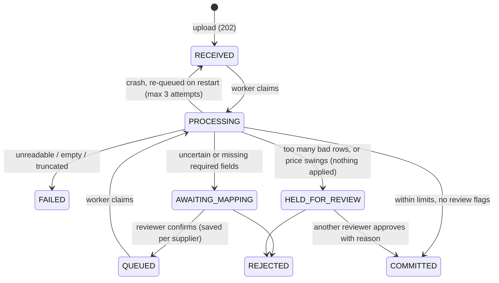
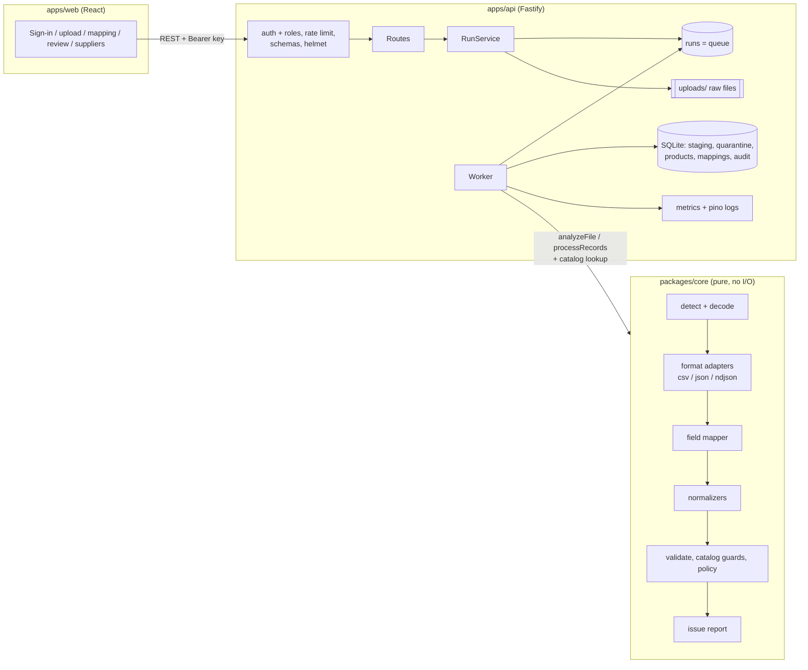

# Supplier feed intake

An ingestion and normalization service for messy supplier product feeds. It reads CSV, JSON and NDJSON files whose columns and formats change without notice, and maps them onto one product model. Bad rows are set aside with a reason the supplier can act on. A file that is too broken to apply, or suspicious against the live catalog, is held for a person to review.

Built for the Adobe Forward Deployed Engineer take-home and told as a customer engagement:

1. **MVP:** [docs/customer-note.md](docs/customer-note.md) describes the customer and the problem.
2. **Pilot feedback round 1:** [docs/feedback-round-1.md](docs/feedback-round-1.md) records what the customer's ops lead, InfoSec and finance asked for, what we changed, what we negotiated and what we deferred. The security posture is in [SECURITY.md](SECURITY.md).

**Contents:**
[Quick start](#quick-start) · [Local development](#local-development) · [Demo script](#demo-script) · [What it does](#what-it-does) · [Architecture](#architecture) · [Key decisions](#key-decisions-and-trade-offs) · [Security](#security) · [Assumptions](#assumptions) · [Testing](#testing) · [Operations](#observability-and-operations) · [Performance and scaling](#performance-and-scaling) · [Limitations and next steps](#known-limitations-and-what-i-would-do-next) · [Use of AI](#use-of-ai)

## Quick start

Requirements: **Node.js 22.13 or newer**. It uses the built-in `node:sqlite`, so there are no native modules to compile.

```bash
npm install
npm run dev          # API on :3000, UI on http://localhost:5173
```

Or, with Docker installed and no Node needed:

```bash
npm run docker:dev             # live-reload dev container: UI on :3000, API on :3001
docker compose up --build      # production-like image: UI + API on :3000 (rebuild to see changes)
```

Sign in with one of the demo users. The UI has buttons for them in dev and demo builds.

| User   | Role     | API key             | Can                                                                        |
| ------ | -------- | ------------------- | -------------------------------------------------------------------------- |
| Andrei | uploader | `demo-uploader-key` | upload files, view runs, download set-aside rows                           |
| Bogdan | reviewer | `demo-reviewer-key` | + confirm mappings, approve or reject held files, change the bad-row limit |
| Marius | admin    | `demo-admin-key`    | + change saved supplier mappings, read `/metrics`                          |

These keys are public (they are in this README) and stored hashed in `config/api-keys.demo.json`. In production mode the server refuses to start with them unless `ALLOW_DEMO_KEYS=true`. See [SECURITY.md](SECURITY.md).

Other commands:

```bash
npm test             # 191 tests: core pipeline, format contracts, security, API flows, crash recovery
npm run lint && npm run format:check && npm run typecheck
npm run audit:prod   # npm audit on production dependencies (CI gate)
npm start            # builds the UI and serves UI + API from :3000
npm run ingest -- fixtures/peak/catalog.json --partner peak --accept-suggestions   # CLI, no server needed
```

- API docs (OpenAPI / Swagger UI): http://localhost:3000/docs
- State lives in `./data` (SQLite database and stored uploads). Delete the folder to start fresh.
- Configuration is through environment variables, validated at startup (`apps/api/src/server.ts`). A bad value stops the server with a clear message:

  | Variable                  | Default                       | Purpose                                                            |
  | ------------------------- | ----------------------------- | ------------------------------------------------------------------ |
  | `PORT`, `HOST`            | `3000`, `0.0.0.0`             | Where the API listens                                              |
  | `DATA_DIR`, `DB_PATH`     | `./data`, `$DATA_DIR/feed.db` | Uploads and the SQLite database                                    |
  | `API_KEYS_FILE`           | `config/api-keys.demo.json`   | Key file (hashed keys and roles)                                   |
  | `ALLOW_DEMO_KEYS`         | `false`                       | Must be `true` to use the demo key file with `NODE_ENV=production` |
  | `MAX_UPLOAD_MB`           | `250`                         | Upload size limit                                                  |
  | `LOG_LEVEL`, `LOG_FORMAT` | `info`, auto                  | `pretty` in a terminal and in dev, `json` otherwise                |
  | `SHUTDOWN_TIMEOUT_MS`     | `25000` (1000 in dev)         | How long SIGTERM waits for the current run                         |
  | `VITE_URL`                | `http://localhost:5173`       | Where the API's `/` redirects in dev                               |

## Local development

### In Docker (nothing installed on the host)

```bash
npm run docker:dev        # = docker compose -f compose.dev.yaml up --build
```

| URL                   | What                      | Reloads when                                                                                                     |
| --------------------- | ------------------------- | ---------------------------------------------------------------------------------------------------------------- |
| http://localhost:3000 | UI (Vite dev server)      | any file in `apps/web/src`: hot module replacement                                                               |
| http://localhost:3001 | API (`/docs` for Swagger) | `apps/api/src`, `packages/core/src`, `config/*.json` or `fixtures/partners.json` change; restarts take about 1 s |

- **Source:** the repo is bind-mounted. File changes are picked up by polling, which is reliable on macOS and Windows bind mounts.
- **Dependencies** are installed inside the container, into volumes (Linux binaries), and reinstalled automatically when `package-lock.json` changes. Your host `node_modules` is never used.
- **Data** lives in the `feed-dev-data` volume. Reset the database and the installed dependencies with `npm run docker:dev:reset`.
- **Debugging:** port 9229 is published for the Node inspector.
- **Localhost only:** all ports are bound to `127.0.0.1`, because the container uses the public demo keys.
- **Not for dev:** `compose.yaml` (`docker compose up`) is the _production-like_ image. Its UI is built into the image, so it only changes after `--build`.

### On the host

With Node 22.13+ installed, `npm run dev` starts the same two processes, on :5173 (UI) and :3000 (API):

| Process           | URL                                         | Reloads when                                                                                                                                                         |
| ----------------- | ------------------------------------------- | -------------------------------------------------------------------------------------------------------------------------------------------------------------------- |
| UI (Vite)         | http://localhost:5173                       | any file in `apps/web/src`: hot module replacement, no page reload                                                                                                   |
| API (`tsx watch`) | http://localhost:3000 (`/docs` for Swagger) | any imported source in `apps/api/src` or `packages/core/src`, plus `config/*.json` and `fixtures/partners.json`, which are read at startup. Restarts take about 1 s. |

Notes:

- **Use :5173 in dev.** In dev, `http://localhost:3000/` redirects there, so you never see an old build left in `apps/web/dist` by `npm start`.
- **Changes to users or suppliers** (`config/api-keys.demo.json`, `fixtures/partners.json`) restart the API. Reload the page to pick up your new name or role, because the UI reads them at sign-in.
- **Processing during a restart:** a run being processed when the API restarts is re-queued and finishes after the restart.
- **Debugging:** `npm run dev:debug -w apps/api` (with `npm run dev -w apps/web` alongside), then use "Attach to API" in VS Code (`.vscode/launch.json`).
- **Tests in watch mode:** `npm run test:watch`.

## Demo script

Run it in the UI, switching users with **Switch user**. The expected results assume you go in order from a fresh `./data`.

**The MVP story: Nordwind (German ERP CSV)**

| #   | As     | Upload / action                       | Expected                              | What it shows                                                                                                                                      |
| --- | ------ | ------------------------------------- | ------------------------------------- | -------------------------------------------------------------------------------------------------------------------------------------------------- |
| 1   | Andrei | `fixtures/nordwind/week1_catalog.csv` | **Imported**, 30 new                  | Upload returns at once and the run updates by itself. A `;`-separated, decimal-comma, Windows-1252 file is matched entirely through known aliases. |
| 2   | Andrei | `fixtures/nordwind/week2_catalog.csv` | **Needs mapping**                     | An ERP upgrade renamed columns and added `Farbe`. The drift is shown. Andrei can't confirm; the page says a reviewer must.                         |
| 3   | Bogdan | Confirm the mapping                   | **Imported**, 29 updated, 1 set aside | Line 9 has the price "auf Anfrage". The decision is saved for Nordwind and shown in the run history.                                               |
| 4   | Andrei | `fixtures/nordwind/week3_catalog.csv` | **Held for review**                   | No questions this time (saved mapping), but the export lost most prices: 65% bad against a 5% limit, so nothing is applied.                        |
| 5   | Bogdan | Approve with a reason, or reject      | **Imported** / **Rejected**           | The reason is recorded. If Bogdan had uploaded it himself, he couldn't approve it (four-eyes rule).                                                |

**The MVP story: Peak (JSON API)**

| #   | As                  | Upload / action                                                                              | Expected                 | What it shows                                                                                                                                                                                                     |
| --- | ------------------- | -------------------------------------------------------------------------------------------- | ------------------------ | ----------------------------------------------------------------------------------------------------------------------------------------------------------------------------------------------------------------- |
| 6   | Andrei, then Bogdan | `fixtures/peak/catalog.json` (supplier Peak), then confirm `inventory.status` → availability | **Imported**, 29 new     | Nested JSON. `pricing.amount`, `inventory.onHand` and `identifiers.upc` are matched automatically. US dates are read month-first and flagged. A bad UPC drops only that field. A "TBD" price sets that row aside. |
| 7   | Andrei              | `fixtures/peak/inventory.ndjson` (type: inventory update)                                    | **Imported**, 22 updated | One corrupt line and one negative stock value are set aside. Inventory updates never create products.                                                                                                             |
| 8   | Andrei              | `fixtures/peak/catalog_broken.json`                                                          | **Failed**               | A truncated export fails the whole file with "ask the supplier to resend".                                                                                                                                        |

**Feedback round 1**

| #   | As     | Upload / action                                          | Expected                                                  | Feedback item                                                                      |
| --- | ------ | -------------------------------------------------------- | --------------------------------------------------------- | ---------------------------------------------------------------------------------- |
| 9   | Andrei | `fixtures/peak/inventory_late.ndjson` (inventory update) | **Imported**, 22 rows skipped as older than the catalog   | #2: a late stock file doesn't overwrite newer stock                                |
| 10  | Andrei | `fixtures/peak/prices_bug.csv` (price update)            | **Held for review**: "11 prices changed by more than 50%" | #3: every value is valid, but prices are 90% too low                               |
| 11  | Bogdan | Reject it with a reason                                  | **Rejected**                                              | #3, and the history shows who decided                                              |
| 12  | Andrei | `fixtures/peak/prices_small_fix.csv` (price update)      | **Imported**, 1 set aside                                 | #4: 1 bad row in 3 is above 2%, but below the minimum count, so the run isn't held |
| 13  | Marius | Suppliers tab → Nordwind → change or remove a mapping    | Saved and audited                                         | #6: a wrong mapping can be fixed                                                   |
| 14  | Andrei | Upload week 1 again                                      | **409 Duplicate file**                                    | Idempotency by content hash; the UI offers "Import it again anyway"                |

The same flow with curl:

```bash
K='Authorization: Bearer demo-uploader-key'; R='Authorization: Bearer demo-reviewer-key'
curl -H "$K" -F partnerId=nordwind -F importType=full_catalog -F file=@fixtures/nordwind/week2_catalog.csv localhost:3000/api/runs   # 202
curl -H "$K" localhost:3000/api/runs/<runId>                                   # poll until AWAITING_MAPPING
curl -H "$R" -X POST localhost:3000/api/runs/<runId>/mapping -H 'content-type: application/json' \
  -d '{"decisions":{"Artikel-Nr.":"sku","VK-Preis":"price","Lagerbestand":"quantity","Farbe":null}}'
curl -H "$K" localhost:3000/api/runs/<runId>/quarantine -o rejected.csv
curl -H 'Authorization: Bearer demo-admin-key' localhost:3000/metrics | grep feed_
```

The fixtures are generated deterministically (`scripts/generate-fixtures.ts`), except `catalog_broken.json`, which was cut by hand. The tests pin every step above, so if a change breaks the demo, CI fails.

## What it does

1. **Accepts uploads without blocking.** The file streams to disk while being hashed, and the API answers `202`. A worker picks the run up from a durable queue (the `runs` table).
2. **Reads any supported format through one adapter interface.** It detects the format (explicit choice, then file extension, then content sniffing), decodes UTF-8 or falls back to Windows-1252, and streams records. Nested JSON is flattened to dot paths (`pricing.amount`). Oversized records are set aside.
3. **Maps source fields to the product model with a confidence score and a reason.** Known aliases and earlier decisions are applied automatically. Similar-looking names and value patterns become suggestions that a **reviewer** confirms once; the decision is saved per supplier, and admins can change it later.
4. **Normalizes values with the supplier's locale.** For example `1.234,56`, `03/04/2026`, `€12,50`, `Auf Lager`, `https://schema.org/InStock`, EANs that lost a leading zero, and UPCs in scientific notation (rejected). Ambiguous values are resolved by the locale and reported, never guessed silently.
5. **Validates per import type.** A bad value in a required field sets the row aside; a bad value in an optional field drops that field and adds a warning.
6. **Checks against the live catalog.** It skips records that are older than what the catalog already has (by the supplier's timestamp, checked again at commit). It flags prices that move more than 50%.
7. **Decides per file:**
   - **Held for review** when the bad-row rate is over the limit _and_ at least a minimum number of rows are bad, or when any price swing was flagged.
   - Held runs apply nothing until a reviewer (not the uploader) approves with a reason, or rejects.
   - The bad-row limit can be changed per upload by a reviewer, within 0–50% and with a reason.
8. **Reports so people can act.**
   - Issues are grouped by code and column, with counts, example values, locations (CSV line or JSON pointer) and a fix hint.
   - Set-aside rows download with their reasons, formula-escaped for Excel.
   - Every decision appears in the run's history.

Run lifecycle:



## Architecture



```
packages/core/src
  formats/      FormatAdapter interface, registry + detection, csv, json/ndjson, decode, flatten, size limits
  mapping/      header normalization, similarity, proposeMapping / applyDecisions
  normalize/    locale-aware value normalizers
  schema/       canonical product model, import types (config: limits, min count, price swing)
  pipeline/     analyzeFile, processRecords (+ catalog guards), issue aggregation, quarantine export
  errors.ts     issue codes, severity rules, fix hints
apps/api/src    app.ts (routes, schemas, security plugins), auth.ts, runService.ts (commands + worker),
                db.ts (migrations, queue, staging, audit), metrics.ts, server.ts (config, shutdown)
apps/web/src    App.tsx, api.ts, styles.css
config/         API key files (demo keys, stored hashed)
fixtures/       demo supplier files and supplier config (partners.json)
scripts/        fixture generator, CLI, large-feed generator, benchmark, docker-dev.sh
docs/           customer note, feedback round 1, ADRs 1-6, how to add a format
Dockerfile      stages: dev (live reload), build, runtime (production-like)
compose.yaml    production-like container;  compose.dev.yaml: live-reload dev container
.github/        CI (lint, format, typecheck, tests, audit, image smoke test), Dependabot
.vscode/        attach-to-API and debug-test launch configs
```

The core is pure: it takes a byte source, the supplier's locale, a mapping and, optionally, a catalog lookup function. It returns accepted and set-aside records through a sink, plus a decision. The API supplies database-backed implementations; the CLI and the benchmark use in-memory ones.

## Key decisions and trade-offs

Longer write-ups are in [docs/adr](docs/adr).

| Decision                                                                                                                                                                                                 | Why                                                                                                                                         | Cost                                                                                                                                                                                               |
| -------------------------------------------------------------------------------------------------------------------------------------------------------------------------------------------------------- | ------------------------------------------------------------------------------------------------------------------------------------------- | -------------------------------------------------------------------------------------------------------------------------------------------------------------------------------------------------- |
| **Fuzzy mapping with confidence bands** ([ADR 1](docs/adr/0001-fuzzy-mapping-with-confidence-bands.md)). Fuzzy names are capped below the auto band; required fields are never auto-mapped from a guess. | Renamed columns are the most common drift. Asking once beats corrupting silently.                                                           | The first file after a rename needs a person. The customer asked to remove this step and we pushed back ([round 1, #7](docs/feedback-round-1.md#7-just-map-everything-automatically-pushed-back)). |
| **Set rows aside, plus a per-file limit with a minimum count** ([ADR 2](docs/adr/0002-quarantine-and-thresholds.md))                                                                                     | Good rows shouldn't wait for bad ones, but a broken export must not half-apply. The minimum count stops tiny files being held for one typo. | Approval is a manual step.                                                                                                                                                                         |
| **Catalog guards: stale skip and price-swing review**                                                                                                                                                    | Arrival order and value validity are not enough. The catalog is the reference.                                                              | One lookup per record (indexed). Records without a timestamp can't be checked for staleness.                                                                                                       |
| **Staging before commit, staleness re-checked at commit**                                                                                                                                                | "Held" means nothing applied. A late approval never overwrites newer data.                                                                  | An extra write per row.                                                                                                                                                                            |
| **Format adapters behind one interface** ([ADR 3](docs/adr/0003-format-adapters.md))                                                                                                                     | New formats don't touch mapping or validation. A shared contract test suite enforces this.                                                  | Flattening is lossy for complex arrays.                                                                                                                                                            |
| **API keys with three roles and a four-eyes rule** ([ADR 5](docs/adr/0005-api-keys-and-roles.md))                                                                                                        | InfoSec's go-live condition. The roles carry over unchanged to SSO later.                                                                   | Long-lived keys with manual rotation.                                                                                                                                                              |
| **Async processing, with the database as the queue** ([ADR 6](docs/adr/0006-async-processing.md))                                                                                                        | Big files no longer time out or block others. Crash recovery comes without new infrastructure.                                              | One worker. Scale-out needs a queue service and Postgres.                                                                                                                                          |
| **SQLite (`node:sqlite`)** ([ADR 4](docs/adr/0004-sqlite-and-synchronous-processing.md))                                                                                                                 | Zero setup, transactional, and the schema maps onto Postgres. Forward-only migrations via `user_version`.                                   | A single writer.                                                                                                                                                                                   |
| **No LLM in the pipeline**                                                                                                                                                                               | Deterministic, testable, and every decision has a stated reason.                                                                            | Unknown vocabularies need aliases added.                                                                                                                                                           |

## Security

Summary only; the threat model and the list of controls are in [SECURITY.md](SECURITY.md).

- **Access control:** authentication on every `/api` route, three roles, and the four-eyes rule on approvals. There is an append-only audit log of who did what, and reasons are required for approvals and overrides.
- **Untrusted file contents:**
  - formula-escaped CSV exports;
  - null-prototype records (prototype pollution);
  - caps on fields, value length and record size;
  - streaming parsers;
  - an upload size limit.
- **API hygiene:**
  - JSON schemas on all routes, rejecting unknown fields;
  - per-key rate limits;
  - helmet headers with a strict CSP;
  - sanitized download filenames;
  - generic 500s with request ids;
  - credentials redacted from logs.
- **Supply chain and runtime:**
  - `npm audit` on production dependencies gates CI, and Dependabot is configured. The first audit found 2 high and 5 moderate advisories, including path traversal in `@fastify/static`; all are fixed.
  - The container runs as a non-root user with a read-only filesystem.
  - Demo keys are refused in production.

## Assumptions

- **Customer:** a mid-size retailer that ingests supplier product, price and stock feeds into its commerce platform. Pilot users are a handful of named people.
- **One file holds one record type** (products), identified by SKU, which is unique per supplier.
- **Suppliers are configured up front:** locale (decimal separator, date order, default currency) and an optional JSON record path.
- **A full catalog import upserts and never deletes** products that are missing from the file.
- **Price and inventory updates only touch their own fields** and skip SKUs that are not in the catalog yet.
- **Supplier timestamps (`updated_at`) are the clock for staleness.** Records without one are applied.
- **Duplicate SKUs in one file:** the last row wins, with a warning.
- **Dates without a timezone are UTC.** `DD.MM.YYYY` is read day-first. Other ambiguous dates use the supplier's locale and raise a warning.
- **Uploads are at most 250 MB** (`MAX_UPLOAD_MB`). Raw files are kept for audit and re-processing.
- **The same file (by SHA-256) is not re-imported** for the same supplier and import type unless `force=true` is sent.
- **TLS terminates at the company load balancer.**

## Testing

`npm test` runs 191 tests in about 4 seconds:

- **Format contract suite:** every adapter must yield flat records in order, report locations, set a malformed record aside without stopping, fail empty files, and recognize its own sample.
- **Normalizers:** locales, ambiguity, spreadsheet damage, invalid calendar dates, GTIN check digits.
- **Mapper:** aliases (including German), nested paths, the required-field safety rule, value evidence, conflicts, saved decisions, and inherited-property safety.
- **Pipeline:** the demo story end to end; CSV and JSON giving identical output; fatal-file cases.
- **Round 1, core** (`round1.test.ts`):
  - prototype pollution, formula injection and size limits;
  - the minimum-count rule;
  - stale-record and price-swing guards;
  - the truncated-export fixture.
- **API** (Fastify `inject`, in-memory or temp-file DB): the full upload, mapping, hold, approve flow with roles; every round 1 item through HTTP; mapping management with audit.
- **Security** (`security.test.ts`): authentication, the role matrix, the four-eyes rule, hashed keys, schema validation, filename sanitizing, formula escaping on download, size limits, rate limiting, headers, health and readiness, and the OpenAPI spec.
- **Reliability:** crash recovery (re-queue, give up after 3), and queue order.

Deliberately not covered:

- browser end-to-end tests (the UI was checked with scripted screenshots during development);
- load tests in CI;
- property-based fuzzing of the parsers. Fuzzing is the first thing I would add.

## Observability and operations

- **Structured logs** (pino JSON; pretty-printed in a TTY). Every run logs these events:
  - `run.received`, `run.analyzed`, `run.awaiting_mapping`, `run.mapping_confirmed`;
  - `run.processed` (counts, error rate vs limit, hold reasons, duration, records/s, top issue codes, commit stats);
  - `run.approved`, `run.rejected`, `run.failed`, `run.recovered`, `run.gave_up`.

  They carry `runId`, `partnerId` and the actor. Auth failures and rate limiting are logged at `warn`, and keys are redacted.

- **Audit log** at `GET /api/audit` (reviewer and above), shown per run in the UI.
- **Metrics** at `/metrics` (admin key):
  - `feed_runs_total{partner,import_type,format,status}`
  - `feed_records_total{partner,format,outcome}` (accepted, quarantined, skipped_stale)
  - `feed_issues_total{partner,code,severity}`
  - `feed_schema_drift_total`
  - `feed_run_duration_seconds`
  - `feed_runs_waiting{status}`: runs waiting on a person
  - `feed_queue_depth{status}`: worker backlog
- **Health checks:**
  - `/health`: liveness; public, returns no data.
  - `/ready`: readiness; checks the DB and reports the schema version. The Docker healthcheck uses it.
- **Alerts I would set:**
  - a run held or failed for a supplier;
  - `feed_runs_waiting` above zero for more than N hours;
  - `feed_queue_depth` growing;
  - a spike in the quarantine rate for a supplier;
  - unexpected schema drift;
  - a `PRICE_SWING` count above zero (finance would want to know);
  - p95 run duration growing.

## Performance and scaling

Measured in Claude's Linux dev environment. Reproduce with:

```bash
npm run gen:large -- 1000000 csv          # or: <rows> ndjson | json
npm run bench -- fixtures/generated/large_1000000.csv
# inside the Docker dev container:
docker compose -f compose.dev.yaml exec feed-intake-dev npm run bench -- fixtures/generated/large_1000000.csv
```

| Workload                                                   | Result                                                                                                               |
| ---------------------------------------------------------- | -------------------------------------------------------------------------------------------------------------------- |
| Core pipeline, 1M-row CSV (71 MB, 2% defects)              | ~75k records/s, peak RSS about 275–325 MB                                                                            |
| Core pipeline, 100k-row NDJSON                             | ~80k records/s                                                                                                       |
| Core pipeline, 100k-row JSON document (`{"products":[…]}`) | ~22k records/s. The token-level streaming JSON parser costs about 3× CSV/NDJSON; still well within a nightly window. |
| API end to end, 100k-row CSV                               | upload answered in 0.06 s; committed after 4.5 s (analyze, stage, catalog guards, promote)                           |

**Where the time and memory go:**

- **Parsing and normalization** are CPU-bound on one core. For large JSON documents the parser dominates; asking suppliers for NDJSON (or a faster SIMD JSON parser) is the lever.
- **Memory** is the SKU set used for duplicate detection; issue aggregation is bounded.
- **In the API,** the cost is per-row SQLite statements (stage, catalog lookup, promote), serialized by the single writer.

**How it would scale** ([ADR 6](docs/adr/0006-async-processing.md)):

1. Use object storage for raw files.
2. Use a queue service, with workers scaled on `feed_queue_depth` and at most one in-flight run per supplier.
3. Use Postgres with `SKIP LOCKED` claims, `COPY` into staging and a set-based upsert.
4. Replace the SKU set with a Bloom filter or a staging-table unique index for very large catalogs.
5. Keep raw files so runs can be replayed after a fix.

## Known limitations and what I would do next

Deferred in round 1, with reasons in [feedback-round-1.md](docs/feedback-round-1.md):

- **SSO** (OIDC with the company IdP) instead of API keys.
- **A supplier self-service portal.**
- **XML feeds:** the adapter layer is ready ([docs/adding-a-format.md](docs/adding-a-format.md)).
- **Email and Slack alerts.** The metrics exist; routing belongs in their monitoring stack.
- **Round 2 candidates:**
  - a supplier onboarding step to pre-approve column names;
  - "confirm all suggestions with value evidence";
  - a retention policy for raw files;
  - shipping audit events to write-once storage;
  - LLM-assisted _suggestions_ for unknown headers, behind the same confirmation step;
  - per-supplier tuning of thresholds from history;
  - variants and attributes;
  - currency conversion.

## Use of AI

I built this together with Claude (Anthropic) as a pair programmer, across two sessions: the MVP, then feedback round 1.

**I decided**, after Claude asked clarifying questions:

- the customer scenario and the API + UI shape;
- TypeScript over PHP (my main language), for one type system end to end;
- fuzzy mapping with confidence bands;
- per-import-type thresholds that can be overridden per upload;
- a pluggable format layer;
- no LLM in the product;
- for round 1: framing the hardening work as a customer feedback round, which requests to implement, API keys with roles over sessions or OIDC for the pilot, and which hygiene items mattered;
- for the developer experience: live reload, both on the host and inside a Docker dev container.

**AI generated** most of the code, tests, fixtures and first drafts of these docs, working from that plan.

- It proposed specifics that I reviewed and kept: the band values, the required-field safety rule, staging before commit, `node:sqlite`, the four-eyes rule, and turning the "reject big price changes" request into a review hold.
- It ran the gap analysis against a typical senior-interview bar that produced the security findings. `npm audit` then found the real dependency vulnerabilities.

**Not delegated to AI:**

- the risk policy (what may be applied automatically, what must hold, who may approve);
- the stories the fixtures tell;
- checking that the behaviour matches what an ops team would want.

The tests pin those decisions so they can't drift silently.
